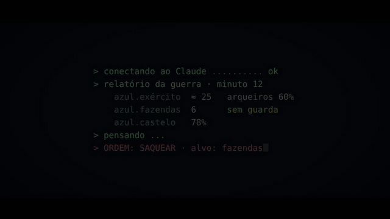

# Reino Pequeno

Estratégia medieval em tempo real, no estilo Age of Empires, Stronghold e Warcraft. Produzido por **Braian Tech**.

Construa a vila, avance pelas cinco eras, negocie com as vilas neutras, contrate mercenários e heróis, monte o exército com generais e derrube o castelo do Reino Vermelho. Roda no navegador, no computador e no celular, também sem internet.

## Trailer da 2.1: o Claude comanda o Reino Vermelho

[](https://braiantech-br.github.io/Reino-Pequeno/trailer/ReinoPequeno-2.1-Trailer.mp4)

▶ [Assistir no navegador](https://braiantech-br.github.io/Reino-Pequeno/trailer/ReinoPequeno-2.1-Trailer.mp4) · [Baixar o trailer (horizontal, 1080p)](https://github.com/Braiantech-br/Reino-Pequeno/raw/main/trailer/ReinoPequeno-2.1-Trailer.mp4) · [Baixar a versão vertical (Reels, Shorts, TikTok, Status)](https://github.com/Braiantech-br/Reino-Pequeno/raw/main/trailer/ReinoPequeno-2.1-Trailer-vertical.mp4)

## Jogar

| Onde | Como |
|---|---|
| **Navegador (qualquer aparelho)** | https://braiantech-br.github.io/Reino-Pequeno/ |
| **iPhone e iPad** | Abra o link acima no Safari → Compartilhar → *Adicionar à Tela de Início* |
| **Windows 10/11** | [ReinoPequeno-Windows.zip](https://github.com/Braiantech-br/Reino-Pequeno/raw/main/downloads/ReinoPequeno-Windows.zip) |
| **Mac** | [ReinoPequeno-Mac.zip](https://github.com/Braiantech-br/Reino-Pequeno/raw/main/downloads/ReinoPequeno-Mac.zip) |
| **Linux** | [ReinoPequeno-Linux.zip](https://github.com/Braiantech-br/Reino-Pequeno/raw/main/downloads/ReinoPequeno-Linux.zip) |
| **Android 5.0+** | [ReinoPequeno-Android.apk](https://github.com/Braiantech-br/Reino-Pequeno/raw/main/downloads/ReinoPequeno-Android.apk) |
| **iPhone/iPad em outro site** | [ReinoPequeno-iPhone-iPad.zip](https://github.com/Braiantech-br/Reino-Pequeno/raw/main/downloads/ReinoPequeno-iPhone-iPad.zip) (arquivos do web app) |

Os instaladores ficam na pasta [downloads](downloads/). Depois de instalados, eles se atualizam sozinhos.
As versões anteriores continuam disponíveis em [downloads/old](downloads/old/).
Instruções de cada sistema, regras e controles: [LEIA-ME.txt](LEIA-ME.txt).

## Novidades da versão 2.2

- **Modo observador: máquina contra máquina.** Na Batalha Rápida, escolha quem joga cada reino: *Você*, *Computador* ou *Claude* no Azul; *Computador* ou *Claude* no Vermelho. Com uma máquina no Azul, as duas jogam e você assiste, até **Claude contra Claude**, com placar, câmera automática que segue as batalhas e os pensamentos e provocações de cada Claude na tela. Feito para transmitir ao vivo.
- **Bem menos notificações**, principalmente no celular e no tablet. Em *Som e avisos* você escolhe Poucos, Normais ou Todos; o que não aparece fica no Conselho, em Notícias.
- **A barra de cima não esconde mais Pausar, Som e Menu:** eles ficam sempre visíveis (ícones nas telas pequenas). Ao voltar para o jogo aparece o cartão *Jogo pausado* com o botão Continuar.
- No Android, as barras do sistema voltam a se esconder depois de desbloquear a tela.

## Novidades da versão 2.1

- **O Claude comanda o Reino Vermelho.** Na Batalha Rápida, escolha "Claude" em *Quem comanda o Reino Vermelho*. A cada minuto o Claude lê um relatório da guerra e decide a estratégia: economia, eras, tropas, construções, ataques, saques, cercos a vilas, contratos e impostos. O Mestre Rubro provoca você com as frases dele, e no fim da partida você lê tudo o que ele pensou.
- No link do jogo no claude.ai o Claude usa a sua conta do Claude. Nas versões baixadas e no site, use a sua chave da API da Anthropic (fica só no aparelho).

## Novidades da versão 2.0

- **Contratos com as vilas:** mercenários por 5, 10 ou 15 minutos ou até a morte, herói da vila, guarnição, proteção, aliança juramentada e rota fixa. Um mensageiro leva cada proposta a pé; a vila aceita, recusa ou pede mais.
- **Honra:** quem cumpre contratos paga menos; quem quebra, saqueia ou ataca vilas paga mais e é recusado.
- **Tropas de elite e heróis** próprios de cada vila (Guarda de escudo, Machadeiro, Besteiro, Sapador; Mãe Moleira, Tora, Capitã Ourela, Grão-Mineiro).
- **Exército com hierarquia:** o de maior patente comanda, empates vão a voto, grupos com chefes e subchefes, comandos de patente e ordens ao general.
- **Batedores e plano de guerra:** o general estuda o terreno e propõe muralhas, torres no morro, fossos e emboscadas, obra por obra, com o motivo. Espionagem da base inimiga para atacar pelo lado fraco.
- **Névoa de guerra** opcional.
- **Economia interna:** impostos, humor do povo, feira com fama, soldo, caravanas e pedágio.
- **Conquista de vilas,** vassalos, revoltas e leilão. O Reino Vermelho faz tudo isso também, com o engenheiro Mestre Rubro.
- **Conselho:** um lugar só para pedidos, exército, contratos, estradas, economia e regras.

## Atualizações automáticas

As versões baixadas (Windows, Mac, Linux, Android e o arquivo .html) têm o botão **Procurar atualização** na tela inicial. Ele lê [`atualizacao/versao.json`](atualizacao/versao.json) neste repositório e, se houver versão nova, baixa [`atualizacao/jogo.html`](atualizacao/jogo.html), confere a assinatura SHA-256 e passa a usar a versão nova, sem reinstalar. Se a versão nova não abrir, o jogo volta sozinho para a anterior.

O site (GitHub Pages) e o web app do iPhone sempre abrem a versão mais nova quando há internet.

Ou seja: **publicar uma versão nova é só atualizar este repositório.** O passo a passo está em [COMO-ATUALIZAR.md](COMO-ATUALIZAR.md).

## O que tem aqui

```
index.html, manifest.webmanifest, sw.js, icon-*.png   o jogo on-line (GitHub Pages) e o web app
downloads/                                            os instaladores (Windows, Mac, Linux, Android, iPhone)
atualizacao/versao.json, atualizacao/jogo.html        o canal de atualização dos jogos baixados
LEIA-ME.txt                                           manual: instalação, regras, controles
COMO-ATUALIZAR.md                                     como publicar uma versão nova
codigo/src/                                           o código do jogo (JavaScript, HTML, CSS)
codigo/build.py                                       monta a página para testar (codigo/preview.html)
codigo/pacotes/empacotar.py                           monta todos os downloads e o site de uma vez
codigo/pacotes/notas/                                 as novidades de cada versão
codigo/testes/                                        testes automáticos da simulação (Node)
codigo/fontes/                                        fontes Jersey 10 e Pixelify Sans (OFL)
```

## Créditos

- Jogo: **Braian Tech** (www.braiantech.com.br)
- Arte: [Tiny Swords](https://pixelfrog-assets.itch.io/tiny-swords), de Pixel Frog. As imagens ficam só dentro do jogo pronto; elas não são publicadas soltas neste repositório.
- Fontes: Jersey 10 e Pixelify Sans (SIL Open Font License, em `codigo/fontes/`).
- Música e vozes: geradas pelo próprio jogo, no aparelho.
